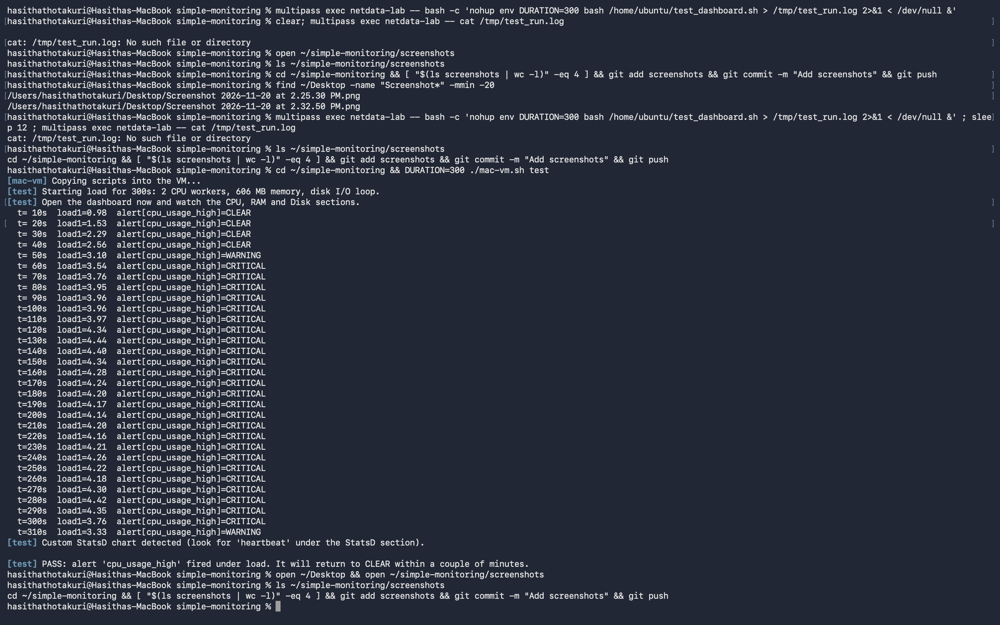

# Simple Monitoring Dashboard with Netdata

A small, repeatable setup that installs [Netdata](https://github.com/netdata/netdata) on Linux,
adds a custom alert and a custom chart, and provides scripts to load-test and tear it all down.

## Layout

| File | Purpose |
|---|---|
| `setup.sh` | Installs Netdata, opens the dashboard, adds the custom CPU alert (Linux) |
| `test_dashboard.sh` | Generates CPU / memory / disk load, feeds a custom chart, checks the alert fires (Linux) |
| `cleanup.sh` | Uninstalls Netdata and removes leftovers (Linux) |
| `mac-vm.sh` | macOS helper: creates an Ubuntu ARM64 VM with Multipass and runs the scripts above inside it |
| `.github/workflows/ci.yml` | ShellCheck + end-to-end run on a GitHub runner |

## Why a VM on the MacBook?

The project is about monitoring a **Linux** system. macOS is not the target platform, and a Docker
container has no systemd and only sees the container VM's resources. A small Ubuntu VM
gives a real Linux host (systemd, `/proc`, disks) so the scripts behave exactly as they would on a server.
Apple Silicon runs an ARM64 Ubuntu guest natively, and Netdata supports ARM64.

## Quick start (macOS)

```bash
brew install --cask multipass        # one-time
chmod +x *.sh
./mac-vm.sh up                       # VM + install + opens http://<vm-ip>:19999
./mac-vm.sh test                     # ~2 min of load; watch the dashboard
./mac-vm.sh cleanup                  # uninstall Netdata (VM stays)
./mac-vm.sh destroy                  # delete the VM
```

## Quick start (any Debian/Ubuntu Linux host)

```bash
chmod +x *.sh
sudo ./setup.sh
./test_dashboard.sh
sudo ./cleanup.sh --purge
```

## Requirements checklist

| Requirement | How it is met |
|---|---|
| Install Netdata on Linux | `setup.sh` runs the official `kickstart.sh` non-interactively |
| Monitor CPU, memory, disk I/O | Enabled by default; load is generated by `test_dashboard.sh` |
| Access via browser | `http://localhost:19999` (inside the VM) or `http://<vm-ip>:19999` (from the Mac) |
| Customize the dashboard | Custom StatsD metric `devops.demo.heartbeat` creates a new chart (see below) |
| Alert on a metric | `cpu_usage_high`: WARNING above 80%, CRITICAL above 95% (1-minute average) |
| Automation | `setup.sh`, `test_dashboard.sh`, `cleanup.sh` + CI workflow |

## The manual steps (do these once to learn, then rely on the scripts)

```bash
# 1. Install
wget -O /tmp/netdata-kickstart.sh https://get.netdata.cloud/kickstart.sh
sh /tmp/netdata-kickstart.sh --non-interactive

# 2. Open the dashboard
#    http://<host>:19999

# 3. Write a custom alert
sudo /etc/netdata/edit-config health.d/custom_cpu_alert.conf
sudo netdatacli reload-health

# 4. Add a custom chart via StatsD (Netdata listens on UDP 8125 by default)
echo "devops.demo.heartbeat:42|g" > /dev/udp/127.0.0.1/8125
```

The alert definition used here:

```
alarm: cpu_usage_high
   on: system.cpu
lookup: average -1m unaligned of user,system,softirq,irq,guest
 units: %
 every: 10s
  warn: $this > 80
  crit: $this > 95
  info: CPU utilization (1-minute average) is above 80%
    to: sysadmin
```

## Verifying it worked

1. Dashboard loads and shows CPU, RAM and Disk sections.
2. During `test_dashboard.sh`, CPU and memory charts climb and disk throughput appears.
3. The script prints `alert[cpu_usage_high]=WARNING` (or `CRITICAL`) and ends with `PASS`.
4. A `heartbeat` chart appears in the StatsD section.
5. After `cleanup.sh`, `curl http://127.0.0.1:19999` fails and the `netdata` binary is gone.

## Configuration knobs

| Variable | Used by | Default |
|---|---|---|
| `NETDATA_CHANNEL` | `setup.sh` | `stable` |
| `NETDATA_BIND` | `setup.sh` | `*` (use `127.0.0.1` to keep the dashboard local) |
| `CPU_WARN`, `CPU_CRIT` | `setup.sh` | `80`, `95` |
| `DURATION` | `test_dashboard.sh` | `120` seconds |
| `VM_NAME`, `VM_CPUS`, `VM_MEM`, `VM_DISK` | `mac-vm.sh` | `netdata-lab`, `2`, `2G`, `15G` |

## Security notes

- The dashboard binds to all interfaces so the Mac can reach the VM. That is fine on Multipass's
  private NAT network; on a real server, set `NETDATA_BIND=127.0.0.1` or put it behind a firewall/reverse proxy.
- `setup.sh` downloads and runs the official installer over HTTPS. For production, verify the script's
  checksum first (see Netdata's install docs).
- Telemetry is disabled during install (`DISABLE_TELEMETRY=1`).

## Troubleshooting

| Symptom | Check |
|---|---|
| Dashboard not reachable from the Mac | `./mac-vm.sh status` for the VM IP; `curl http://<ip>:19999/api/v1/info` |
| Alert never fires | Run longer: `DURATION=240 ./mac-vm.sh test`; inspect `curl -s localhost:19999/api/v1/alarms?all \| jq` |
| Install fails | `sudo journalctl -u netdata -n 50`; check the VM has internet access |
| Custom chart missing | Confirm UDP 8125 is listening: `ss -ulpn \| grep 8125` |

## Screenshots



